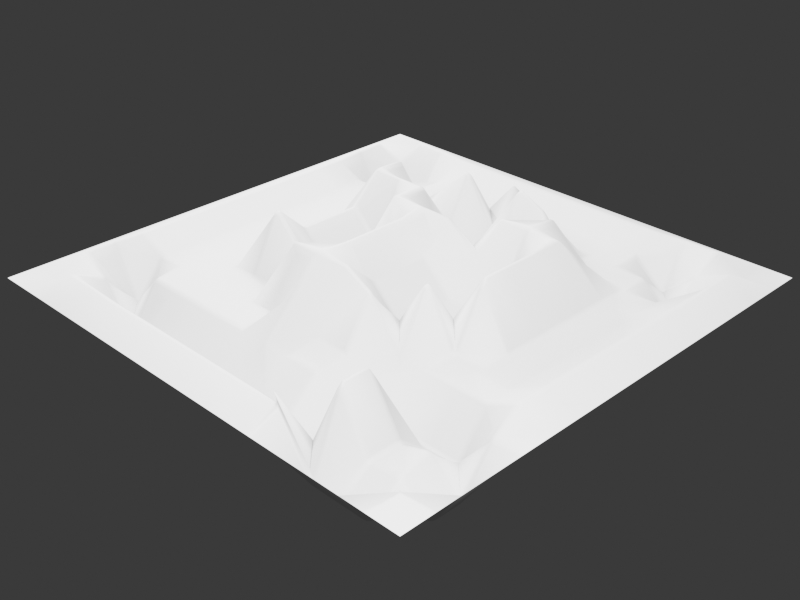

# xl_c4d_tool

面向 Blender 5.1 的中文 C4D 风格工作流工具集。公开仓库从开发母版以许可白名单重新组装；首个公开核心版重点提供经过验证的 `XL_置换` 2.0、修改器库框架、场景辅助、Node Preview 和四边重拓扑入口。

> Cinema 4D / C4D 是其权利人的商标。本项目是独立 Blender 工具，与 Maxon、Blender Foundation 或文中第三方项目没有官方隶属、赞助或背书关系。



## 为什么公开版只有审计后的核心资产

开发母版曾包含 286 个几何节点组、118 个标记资产以及若干研究/商业依赖。署名不能代替授权，因此这个仓库没有直接上传母版：

- 随附 `assets/C4D生成器复刻.blend` 只保留已审计的 `XL_置换`；文件中没有对象、图像、外部库或本机路径。
- Geo-Scatter `non_gpl`、PF Hardshell、Advanced Array、来源不明或商业资产全部排除。
- 依赖 CGMatter、SuperLoft、缺失外部 `.blend` 或未完成许可确认的节点暂不公开。
- 后续资产会在来源、许可证和脱离本机路径验证通过后逐个加入，而不是整包复制。

这使公开版功能少于作者本机完整包，但它可以被审计、合法修改和持续扩展。

## XL_置换 2.0

旧置换的默认输入会被中心化为零，因此添加修改器后经常看不到效果。3.4.0 重建为真正的图像高度工作流：

- 图像输入，命名 UV 与位置坐标回退；
- 平铺、偏移、灰度或 Alpha；
- 底部/顶部级别、中心、高度和反转；
- 点选择、0–6 级安全细分；
- 表面法线或自定义固定方向；
- 可选平滑着色；
- 未指定图像时保持原几何。

节点组包含 18 个接口插槽（含几何输出）、32 个节点、45 条连接，并按 `01`–`07` 中文语义框组织。Blender 5.1.2 自动验证结果：无图像位移为 0；测试图像产生约 `0.437` 的 Z 高度范围；细分测试输出 289 个顶点。

## 安装

推荐从 GitHub Releases 下载 `xl_c4d_tool-3.4.0-public-core.zip`，然后在 Blender 中：

1. 打开 `编辑 > 偏好设置 > 插件`。
2. 选择“从磁盘安装”，直接选择 ZIP。
3. 启用 `xl_c4d_tool`。
4. 在 3D 视图按 `N`，打开 `c4d小工具 > 修改器库`。
5. 选择网格，点击“置换 2.0”，在修改器中指定高度图和 UV。

从源码使用时，将仓库内的 `xl_c4d_tool/` 目录复制到 Blender 插件目录；仓库根目录本身不是插件模块。

## 使用建议

1. 先指定图像和正确的 `UV 名称`。
2. 把 `细分级别` 保持为 0 或 1，确认采样和方向后再增加。
3. 用 `底部级别 / 顶部级别` 压缩黑白范围，用 `中心` 决定凹凸零点。
4. 从较小的 `高度` 开始；高细分和大位移都可能明显增加求值成本。
5. 无 UV 时可关闭“优先 UV”，使用位置坐标配合平铺/偏移。

## 其他公开模块

- 场景整理、对齐、显示模式和布尔操作源显示联动。
- 几何节点分类/搜索和修改器追加框架。
- Node Preview v1.21（Simon Wendsche / B.Y.O.B.，GPL-3.0-or-later）。
- 四边重拓扑入口；QRemeshify / QuadWild / QuadPatches 的详细许可随 `xl_c4d_tool/重拓扑/THIRD_PARTY_LICENSES.md` 提供。

## 设计参考与归属

- `XL_置换` / 浮雕工作流研究参考 [Cashew Nodes](https://github.com/CashewTeam/Cashew_Nodes) 的 Relief 组织方式；作者 Con11，GPL-3.0。本项目重新实现中文接口、UV 回退、图像采样、安全旁路、方向和语义注释框，并记录了修改。
- 一个本地“几何节点图像置换”样例没有可确认作者/许可证，且图像节点未接入有效输出；其 `.blend`、贴图和节点图均未复制或分发。
- 完整来源、修改与排除边界见 [THIRD_PARTY_LICENSES.md](THIRD_PARTY_LICENSES.md)。

## 开发与验证

```powershell
python -m compileall -q xl_c4d_tool
```

几何节点资产必须在 Blender 5.1 中执行自动验证：接口、7 个语义框、无图安全旁路、真实图像位移、细分、保存后重开，以及 0 个外部库引用。

## 许可证

公开核心版按 [GNU GPL v3](LICENSE) 发布。随附第三方组件仍保留各自版权声明和许可证。贡献代码必须与 GPL-3.0 兼容，并且不得加入未获再分发授权的商业源码或资产。

## 支持作者

如果这个工具帮到你，欢迎请作者喝杯奶茶。所有支持均为自愿，不影响插件功能、更新或开源许可。


## 文档

- [版本记录](CHANGELOG.md)
- [开发与资产审计](DEVELOPMENT_LOG.md)
- [第三方许可与公开边界](THIRD_PARTY_LICENSES.md)
- [贡献指南](CONTRIBUTING.md)
- [安全策略](SECURITY.md)
